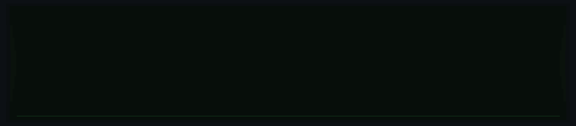

<div align="center">


**Desenvolvedor Full Stack · Web & Mobile**


</div>

---

## 🟩 Sobre mim

```yaml
nome: Scapin
a área: Desenvolvimento Full Stack
foco: Web e Mobile
ecossistema: Vue.js
```

- 🟩 Trabalho com **frontend, backend e aplicativos mobile**.
- 🟩 Tenho experiência com o ecossistema **Vue.js**.
- 🟩 Gosto de construir soluções completas, da interface à API.
- 🟩 Vamos conversar? [@Scapin961](https://github.com/Scapin961)

## 🟩 Tecnologias

<p align="center">
  
</p>

## 🟩 Áreas de atuação

| Área | O que eu curto construir |
|:--|:--|
| 🟩 **Frontend** | Interfaces acessíveis, responsivas e agradáveis de usar |
| 🟩 **Backend** | APIs e serviços para conectar as partes da aplicação |
| 🟩 **Mobile** | Aplicativos práticos para o dia a dia |
| 🟩 **Full Stack** | Soluções completas, da ideia à entrega |

## 🟩 GitHub em movimento

<div align="center">


</div>

<p align="center">
  <a href="https://github.com/Scapin961">
    
  </a>
</p>

---

<div align="center">

### 🟩 Ideias viram código. Código vira experiência.

<a href="https://github.com/Scapin961?tab=repositories">🚀 Explore meus repositórios</a>

<br /><br />


</div>
