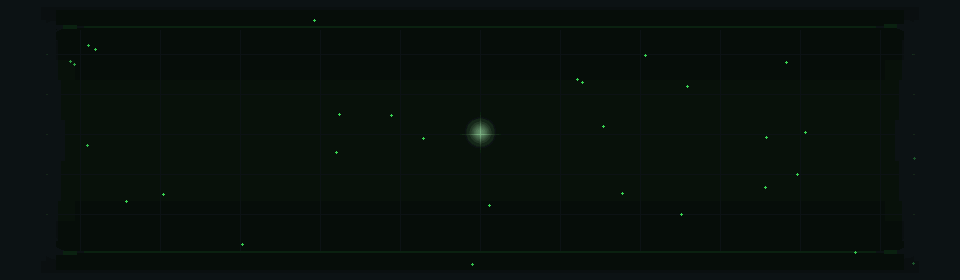
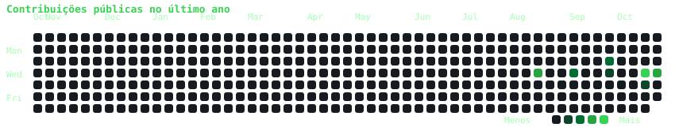
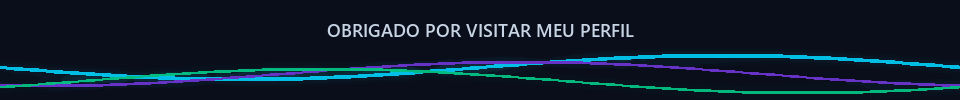

<div align="center">



**Desenvolvedor Full Stack · Web & Mobile**


</div>

---

## 👋 Sobre mim

```yaml
nome: Scapin
a área: Desenvolvimento Full Stack
foco: Web e Mobile
ecossistema: Vue.js
```

- 💻 Trabalho com **frontend, backend e aplicativos mobile**.
- 🟢 Tenho experiência com o ecossistema **Vue.js**.
- 🧩 Gosto de construir soluções completas, da interface à API.
- 📬 Vamos conversar? [@Scapin961](https://github.com/Scapin961)

## ⚡ Tecnologias

<div align="center">


</div>

<p align="center">
  
  
  
  
  
  
</p>

## 🎯 Áreas de atuação

| Área | O que eu curto construir |
|:--|:--|
| 🎨 **Frontend** | Interfaces acessíveis, responsivas e agradáveis de usar |
| ⚙️ **Backend** | APIs e serviços para conectar as partes da aplicação |
| 📱 **Mobile** | Aplicativos práticos para o dia a dia |
| 🔗 **Full Stack** | Soluções completas, da ideia à entrega |

## 📊 GitHub em movimento

<div align="center">


</div>

<p align="center">
  <a href="https://github.com/Scapin961">
    
  </a>
</p>

---

<div align="center">

### ✨ Ideias viram código. Código vira experiência. ✨

<a href="https://github.com/Scapin961?tab=repositories">🚀 Explore meus repositórios</a>

<br /><br />



</div>
